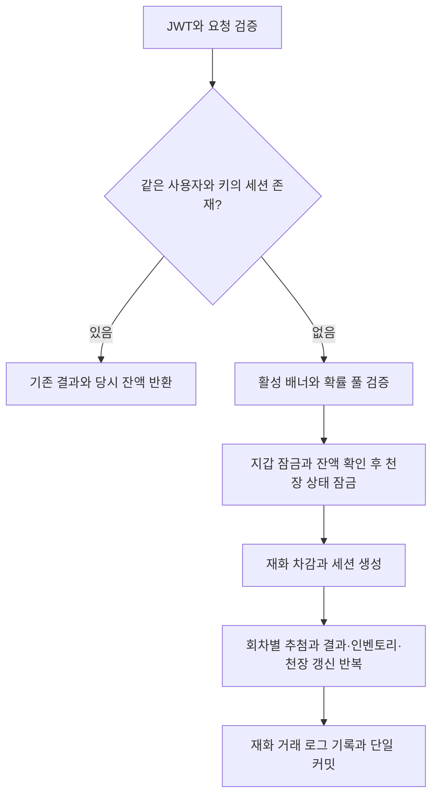

# Gacha Log Analytics System

[](https://github.com/kyjglobal/gacha-log-analytics-system/actions/workflows/ci.yml)

Flutter와 FastAPI로 구현한 가챠 추첨·로그 분석 시스템입니다. 추첨 결과와 재화·인벤토리 변화를 함께 기록하고, 공식 확률과 개인·전체 사용자의 획득 비율을 비교합니다.

## 주요 기능과 기술 구성

- **추첨과 이력**: 1회·10회 추첨, 배너별 천장, 중복 요청 재처리, 세션·결과·거래 로그
- **인벤토리**: 서버에 저장된 보유 수량 조회와 등급별 필터
- **확률 분석과 랭킹**: 등급별 획득 비율, 공식 확률 대비 편차, Luck Score와 최소 표본 기반 랭킹
- **커뮤니티**: 게시글·댓글·좋아요, 본인 추첨 결과를 검증한 확률 인증 게시글
- **관리자**: 사용자 상태 관리, 인벤토리 수량 조정, 추첨 세션 Soft Delete와 거래 기록

| 영역 | 기술 |
| --- | --- |
| Frontend | Flutter, Riverpod, Dio, GoRouter |
| Backend | FastAPI, SQLAlchemy AsyncSession, Pydantic |
| Database | MySQL 8.4 / InnoDB, Alembic |
| 인증·실행 | JWT Bearer, Docker Compose, GitHub Actions |

## 프로젝트 구조

```text
gacha-log-analytics-system/
├── frontend/lib/
│   ├── app/                    # 라우팅·테마
│   ├── core/                   # API 클라이언트·공통 UI
│   └── features/               # 인증·추첨·통계·커뮤니티·관리자
├── backend/app/
│   ├── api/v1/endpoints/       # 요청·응답과 접근 권한
│   ├── services/               # 추첨·집계·거래 처리
│   ├── models/                 # SQLAlchemy 모델
│   └── schemas/                # Pydantic 요청·응답 모델
├── backend/alembic/             # 스키마 변경·초기 배너 데이터
├── backend/tests/
├── docs/                       # 화면·ERD·API·아키텍처 명세
└── docker-compose.yml
```

## 실행

필요하면 `.env.example`을 `.env`로 복사해 기본 설정을 변경합니다.

MySQL과 FastAPI:

```powershell
docker compose up --build
```

API 컨테이너는 DB 상태 확인 후 `alembic upgrade head`로 마이그레이션과 초기 데이터를 적용하고 서버를 시작합니다.

Flutter:

```powershell
cd frontend
flutter pub get
flutter run -d chrome
```

다른 API 주소를 사용하려면 compile-time 환경변수를 지정합니다.

```powershell
flutter run -d chrome --dart-define=API_BASE_URL=http://localhost:8000/api/v1
```

- Swagger UI: <http://localhost:8000/docs>
- OpenAPI JSON: <http://localhost:8000/openapi.json>
- Health check: <http://localhost:8000/health>
- Community: Flutter sidebar의 `Community`

## API 명세

기본 경로는 `/api/v1`입니다. 인증이 필요한 요청은 `Authorization: Bearer <access_token>` 헤더를 사용하고, 관리자 API는 추가로 `role=admin`을 확인합니다.

| 영역 | Method / Path | 접근·주요 입력 |
| --- | --- | --- |
| 회원가입·로그인 | `POST /auth/signup`, `POST /auth/login` | 공개, JSON 본문으로 JWT 발급 |
| 내 계정 | `GET /auth/me`, `PATCH /auth/me`, `DELETE /auth/me` | JWT, 조회·닉네임 변경·비밀번호 확인 후 탈퇴 |
| 배너 | `GET /gacha/banners` | JWT, 활성 배너·확률 풀·재화·천장 상태 |
| 추첨 | `POST /gacha/draw` | JWT + `Idempotency-Key`, `banner_id`, `count`(1 또는 10) |
| 추첨 이력 | `GET /gacha/history` | JWT, `page` 기본 1, `size` 기본 20 / 최대 50 |
| 인벤토리 | `GET /inventory` | JWT, 선택적 `rarity` 필터 |
| 확률 통계 | `GET /statistics/me` | JWT, 선택적 `banner_id` |
| 랭킹 | `GET /rankings` | JWT, 선택적 `banner_id`, `minimum_draws` 기본 10, `limit` 기본 20 / 최대 100 |
| 게시글 조회 | `GET /community/posts`, `GET /community/posts/{post_id}` | 공개, 목록·검색·상세 |
| 게시글 변경 | `POST /community/posts`, `PUT /community/posts/{post_id}`, `DELETE /community/posts/{post_id}` | JWT, 수정·삭제는 작성자 또는 관리자 |
| 좋아요 | `POST /community/posts/{post_id}/like` | JWT, 추가·취소 토글 |
| 댓글 | `GET`, `POST /community/posts/{post_id}/comments`, `PUT`, `DELETE /community/comments/{comment_id}` | 조회는 공개, 작성은 JWT, 수정·삭제는 작성자 또는 관리자 |
| 결과 인증 | `POST /community/certifications` | JWT, 소유한 `gacha_result_id`와 게시글 내용 |
| 관리자 조회 | `GET /admin/dashboard`, `GET /admin/users`, `GET /admin/gacha-sessions` | 관리자 JWT |
| 관리자 조정 | `PATCH /admin/users/{user_id}/status`, `POST /admin/users/{user_id}/inventory-adjustments`, `DELETE /admin/gacha-sessions/{session_id}` | 관리자 JWT |

추가 API 설명과 요청 예시는 [REST API 명세](docs/api-spec.md), 전체 요청·응답 스키마는 실행 중인 서버의 Swagger UI에서 확인할 수 있습니다. 공개 상태 경로 `/health`와 `/api/v1/system/status`는 실제 DB 연결 성공을 검사하는 readiness probe가 아닙니다.

### 추첨 요청·응답 예시

아래 PowerShell 예시는 **이미 가입한 계정**으로 로그인한 뒤 활성 배너에서 1회 추첨합니다. 계정이 없으면 먼저 `POST /auth/signup`에 `email`, `nickname`, `password`를 전달합니다.

```powershell
$apiBase = 'http://localhost:8000/api/v1'
$credentials = @{
    email = 'traveler@example.com'
    password = '<가입한 계정의 비밀번호>'
} | ConvertTo-Json
$login = Invoke-RestMethod -Method Post -Uri "$apiBase/auth/login" `
    -ContentType 'application/json' -Body $credentials

$headers = @{ Authorization = "Bearer $($login.access_token)" }
$banners = Invoke-RestMethod -Uri "$apiBase/gacha/banners" -Headers $headers
if (-not $banners) { throw '활성 배너가 없습니다.' }
$body = @{ banner_id = $banners[0].id; count = 1 } | ConvertTo-Json
$drawHeaders = @{
    Authorization = $headers.Authorization
    'Idempotency-Key' = [guid]::NewGuid().ToString()
}
$draw = Invoke-RestMethod -Method Post -Uri "$apiBase/gacha/draw" `
    -Headers $drawHeaders -ContentType 'application/json' -Body $body
$draw | ConvertTo-Json -Depth 5
```

`200 OK` 응답 구조 예시입니다. 초기 배너와 스키마를 바탕으로 작성한 설명용 값이며, 실제 실행 결과는 아닙니다.

```json
{
  "session_id": 1,
  "banner_id": 1,
  "banner_name": "Celestial Trace",
  "draw_count": 1,
  "total_cost": 160,
  "pity_before": 0,
  "pity_after": 1,
  "balance_after": 12680,
  "created_at": "2026-10-19T12:00:00",
  "results": [
    {
      "id": 1,
      "item_id": 5,
      "item_name": "Mana Potion",
      "rarity": "common",
      "sequence": 1,
      "official_probability": 0.488,
      "applied_probability": 0.488,
      "random_value": 0.75,
      "was_pity_applied": false
    }
  ]
}
```

추첨 API의 주요 오류:

| Status | 조건 |
| --- | --- |
| `401` | 인증 정보 누락·만료·오류 또는 비활성·삭제 사용자 |
| `404` | 사용 가능한 활성 배너가 없음 |
| `409` | 재화 부족, 지갑 없음, 빈 확률 풀, 기본 확률 합 불일치, 천장 후보 없음 |
| `422` | 1·10 이외의 추첨 수, 필수 필드·헤더 누락 또는 형식 검증 실패 |

서비스 오류는 `{"detail":"보유 재화가 부족합니다."}`처럼 반환하며, FastAPI의 필드 검증 오류는 `detail`에 오류 목록이 들어갑니다.

## 핵심 처리 로직

### 1. 추첨과 데이터 정합성

클라이언트는 추첨 요청과 결과 표시를 담당하고, 확률 계산·재화 차감·천장 갱신은 서버에서 처리합니다.



- SQLAlchemy `AsyncSession`에서 지갑·천장·기존 인벤토리 행에 `SELECT ... FOR UPDATE`를 사용합니다.
- 재화 차감, 세션·결과 생성, 인벤토리 증가, 천장 갱신, 거래 로그를 하나의 트랜잭션으로 커밋하며 예외 시 롤백합니다.
- 인벤토리는 `(user_id, item_id)` 유일 제약으로 관리하고, 획득마다 `gacha_acquire`, 세션마다 `gacha_spend` 거래를 남깁니다.

구현: [GachaService](backend/app/services/gacha_service.py), [가챠 모델](backend/app/models/gacha.py), [인벤토리 모델](backend/app/models/inventory.py)

### 2. 가중 추첨과 천장

활성 아이템의 기본 확률 합이 `1`인지 오차 `0.00000001` 이내로 검사합니다. `SystemRandom`의 난수를 소수점 8자리로 내림하고, `base_probability × pickup_weight`의 누적 가중치 구간으로 아이템을 선택합니다.

매 회차 직전 `현재 천장 카운터 + 1 >= pity_threshold`이면 후보를 `mythic`으로 제한합니다. 신화 획득 시 카운터를 `0`으로 초기화하고, 그 외에는 `1`씩 늘립니다. 10회 추첨 안에서도 앞 회차의 결과가 다음 회차의 천장에 반영됩니다.

| 초기 데이터 | 값 |
| --- | --- |
| 배너 | `Celestial Trace` (`id=1`) |
| 1회 비용 / 천장 | `160` / `80회` |
| 기본 확률 | 신화 1.2%, 전설 5%, 영웅 15%, 희귀 30%, 일반 48.8% |
| Pickup weight | 모든 아이템 `1` |

위 수치는 [초기 seed](backend/alembic/versions/0002_seed_gacha_catalog.py) 설정입니다. 현재 천장은 임계 횟수에서 신화 후보를 보장하는 방식이며, 횟수에 따라 확률을 점진적으로 올리는 로직은 적용하지 않습니다.

결과 로그의 `official_probability`는 해당 아이템의 기본 확률입니다. `applied_probability`는 현재 일반 추첨에서 기본 확률, 천장에서는 `1`을 저장합니다. 따라서 가중치를 변경하거나 신화 후보가 여러 개이면 이 필드를 개별 아이템의 정규화된 실효 확률로 해석할 수 없습니다.

### 3. 중복 요청 처리

`Idempotency-Key`는 필수이며 길이는 `8–64`자입니다. 새 추첨에는 UUID처럼 전역에서 고유한 키를 만들고, 응답 유실 등으로 **같은 추첨을 재시도할 때만 같은 키와 본문**을 사용합니다. 위 예시의 재시도는 마지막 추첨 요청에 기존 `$drawHeaders`와 `$body`를 그대로 전달합니다.

동일 사용자·동일 키의 미삭제 세션이 있으면 추가 추첨이나 차감 없이 저장된 결과와 **그 거래 직후의 잔액**을 반환합니다. 관리자가 Soft Delete한 세션의 키를 재사용하면 `404`입니다. 현재 요청 본문과 기존 `banner_id`·`count`의 일치 여부는 비교하지 않으며, DB의 키 유일 제약은 사용자별이 아닌 전역 범위입니다.

### 4. 확률 통계와 Luck Score

통계는 같은 배너의 **완료(`completed`)·미삭제 세션에 속한 결과 행**을 집계합니다. 개인 통계는 본인 결과, 전체 통계는 본인을 포함한 모든 사용자의 결과를 사용합니다.

```text
등급별 공식 확률 = 배너 풀의 해당 등급 base_probability 합
개인·전체 획득 비율 = 해당 등급 획득 수 / 해당 집계의 전체 결과 수
개인 편차 = 개인 획득 비율 - 공식 확률

기대 가중치 E = Σ(등급별 공식 확률 × 등급 가중치)
관측 가중치 O = Σ(등급별 개인 획득 비율 × 등급 가중치)
Luck Score = round(O / E × 100, 2)
```

등급 가중치는 `mythic=100`, `legendary=20`, `epic=5`, `rare=2`, `common=1`입니다. Luck Score `100`은 관측 가중치가 기본 확률의 기대 가중치와 같다는 뜻이며 상한은 없습니다. 개인 표본이 없거나 기대 가중치가 `0`이면 점수는 `0`입니다.

API의 확률·편차는 소수 단위입니다. 예를 들어 `0.012`는 `1.2%`, 편차 `0.008`은 `+0.8%p`입니다. 천장 결과도 집계에 포함하므로 기본 확률과의 단순 비교이며, 천장을 반영한 이론 확률이나 통계적 유의성 검정은 아닙니다. 전체 통계는 사용자 상태를 별도로 제외하지 않습니다.

구현: [StatisticsService](backend/app/services/statistics_service.py)

### 5. 랭킹과 확률 인증

- **랭킹**: 활성·미탈퇴 사용자의 완료·미삭제 결과 중 최소 추첨 수(기본 10회)를 충족한 사용자를 평가합니다. `Luck Score 내림차순 → 추첨 수 내림차순 → 사용자 ID 오름차순`으로 정렬하고 연속 순위를 부여합니다. `my_rank`는 반환 목록의 `limit`과 관계없이 전체 적격 사용자에서 계산하며, 자격 미충족 시 `null`입니다.
- **인증**: 본인의 완료·미삭제 추첨 결과인지 서버에서 확인하고 게시글과 인증 스냅샷을 함께 저장합니다. 결과당 한 번만 인증할 수 있으며, 이후 게시글 내용을 수정해도 스냅샷은 다시 계산하지 않습니다.
- **인증 집계 범위**: 같은 사용자·배너에서 선택한 세션 ID 이하의 유효 세션 전체입니다. 10회 추첨이면 선택한 결과의 순번과 관계없이 해당 세션의 10개 결과를 모두 포함합니다. 인증의 `official_probability`는 선택한 **아이템**의 기본 확률, `personal_probability`는 선택한 **등급**의 누적 획득 비율입니다.

구현: [RankingService](backend/app/services/ranking_service.py), [CommunityService](backend/app/services/community_service.py)

## 구현·검증 범위

- 통계는 별도 집계 테이블 없이 원본 세션·결과를 조회합니다. 대량 데이터에서의 처리 성능 수치는 아직 제시하지 않습니다.
- 대시보드의 활동 차트·최근 이력·일부 지표에는 고정 시연 값이 포함되어 있습니다.
- [가챠 단위 테스트](backend/tests/test_gacha_service.py)는 확률 합·선택 경계·천장 후보를, [통계 테스트](backend/tests/test_statistics_service.py)와 [랭킹 테스트](backend/tests/test_ranking_service.py)는 계산·정렬 규칙을 확인합니다. DB 동시성·멱등성 통합 검증과는 구분합니다.

## 관련 문서와 개발 규칙

- [REST API 명세](docs/api-spec.md)
- [아키텍처와 기능별 처리 흐름](docs/architecture.md)
- [ERD](docs/erd.md) · [화면 명세](docs/screens.md)
- [기여 절차](CONTRIBUTING.md) · [Git 브랜치 및 커밋 전략](docs/git-strategy.md)

모든 개발은 `develop`에서 생성한 `feature/*` 브랜치에서 수행합니다. 커밋 메시지는 `type(scope): 한국어 설명` 형식을 사용합니다.

Pull Request에서는 Git 정책 검사와 함께 Backend tests, Flutter checks, Docker Compose validation을 모두 통과해야 합니다.
